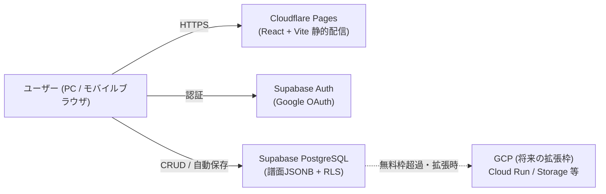

# 譜面作成ソフト 設計・実装計画書

ブラウザ上で動作し、PC・モバイルの両方でシンプルかつ直感的に使える譜面作成ソフトの仕様・アーキテクチャ・データモデル・段階的実装計画。

---

## 1. コンセプトと基本方針

- **シンプル・直感的**: MuseScoreのような「パート／楽器設定」「入力モード切替」「複雑な休符分割」を排し、**五線と声部（1st, 2nd...）を直接扱う**設計にする。
- **DAW風の自由配置 × 楽譜浄書**: 内部は厳密なTickベースのグリッド配置とし、隙間は描画時に休符として自動補完する。
- **PC・モバイル両対応**: PCではショートカット＋マウスで高速に、モバイルでは下部親指ツールバー＋ピンチズームで快適に編集できる。
- **クラウド同期前提**: Googleログイン後にマイ譜面一覧からすぐ編集でき、PCとスマホ間で自動同期される。

---

## 2. システム・インフラ構成



| 領域 | 採用技術 | 選定理由 |
| :--- | :--- | :--- |
| **フロントエンド** | React + TypeScript + Vite | 高速な開発体験、型安全なスコアデータ操作 |
| **UI / スタイル** | Tailwind CSS + Lucide Icons | PC/モバイル両対応のレスポンシブUIを軽量に構築 |
| **状態管理** | Zustand（+ Immer / Undo-Redo履歴） | スコア編集のUndo/Redoや声部状態管理がシンプル |
| **楽譜描画** | VexFlow（SVG出力） | 連桁・3連符・複数声部の符尾処理・臨時記号を任せつつ、SVG上でインタラクション層を構築 |
| **PDF / 画像出力** | jsPDF + svg2pdf.js（+ SVG/PNG直接書き出し） | サーバー不要でベクターPDFを直接ダウンロード生成 |
| **MIDI入出力** | `@tonejs/midi` | SMFのパース・生成が安定しておりTickモデルと相性抜群 |
| **プレビュー再生** | Web Audio API（軽量ピアノ風シンセ） | 音源ダウンロード不要でモバイルでも即座に再生可能 |
| **ホスティング** | Cloudflare Pages | 無料枠が広く高速配信 |
| **認証・DB** | Supabase（Google Auth + PostgreSQL + RLS） | 無料枠で運用開始でき、リポジトリ層を抽象化して将来のGCP拡張にも備える |

> **設計メモ**: ストレージ操作は `ScoreRepository` インターフェース経由に抽象化する。初期は Supabase 実装を使い、将来 GCP への移行・拡張が必要になってもアプリ本体のコードを変更せずに差し替え可能にする。

---

## 3. コアデータモデル設計

内部の時間管理は **1四分音符 = 480 ticks** の整数表現を採用する（2・3・4・6・8・12・16分割すべてが割り切れるため、通常音価と3連符を誤差なく混在させられる）。

```ts
type ClefType = 'treble' | 'bass';
type Accidental = '#' | 'b' | 'n';
type DynamicMark = 'pp' | 'p' | 'mp' | 'mf' | 'f' | 'ff';

interface Score {
  id: string;
  title: string;
  subtitle?: string;
  composer?: string;
  tempo: number; // BPM
  timeSignature: { beats: number; beatType: number }; // 例: 4/4, 3/4, 6/8
  keySignature: string; // プリセット: 'C', 'G', 'D', ..., 'F', 'Bb', ...
  staves: Staff[];
  measureMeta: MeasureMeta[]; // 小節ごとのメタ情報（反復記号・将来の改行位置など）
  updatedAt: string;
}

interface MeasureMeta {
  index: number;
  repeatStart?: boolean;
  repeatEnd?: boolean;
  // 将来の印刷レイアウト調整用ヒント
  lineBreakAfter?: boolean;
  pageBreakAfter?: boolean;
}

interface Staff {
  id: string;
  name?: string; // 任意ラベル（空でも可）
  clef: ClefType;
  voices: Voice[]; // 1st, 2nd, 3rd, 4th...
}

interface Voice {
  id: string;
  index: number; // 0 = 1st, 1 = 2nd, ...
  color: string; // 編集時の識別カラー
  muted?: boolean;
  solo?: boolean;
  measures: MeasureVoice[];
}

interface MeasureVoice {
  measureIndex: number;
  notes: NoteEvent[]; // startTick昇順。隙間は描画時に休符として自動生成
}

interface NoteEvent {
  id: string;
  startTick: number;      // 小節内の開始Tick (0 〜 measureTicks - 1)
  durationTick: number;   // 音価 (480=4分, 240=8分, 160=8分3連符 等)
  tuplet?: { numNotes: number; notesOccupied: number }; // 3連符等の明示情報
  pitches: Pitch[];       // 単音は長さ1、和音は長さ2以上
  tieToNext?: boolean;    // 次音符へのタイ（小節またぎ対応）
  slurStart?: boolean;    // スラー開始
  slurEnd?: boolean;      // スラー終了
  dynamic?: DynamicMark;  // 強弱記号
}

interface Pitch {
  step: 'C' | 'D' | 'E' | 'F' | 'G' | 'A' | 'B';
  octave: number;
  accidental?: Accidental;
}
```

---

## 4. UX・インタラクション設計

### 声部の扱いと色分け
- 1st（濃紺/青）、2nd（緑）、3rd（橙）、4th（紫）のように**声部ごとに色分け**して表示する。
- **アクティブな声部のみくっきり表示**し、他の声部はやや薄く（透明度を下げて）表示することで、同一五線上に複数声部があっても見やすく誤編集を防ぐ。
- 声部の追加・切り替えはツールバー上のタブ／バッジ（`1st` `2nd` `+`）でワンタップで行える。

### グリッド自由配置と和音モード
- **基本動作（単音上書きモード）**: 音価を選んで五線上の拍・音高をタップ／クリックすると配置。同じ拍の別音高をタップすると音高が上書き移動する（モバイルでの修正が楽）。
- **和音追加モード**: ツールバーの「和音」ボタンON（PCでは `Shift + クリック`）で、同じ拍に別音高を追加して和音を作成。既存音高の再タップでその音のみ削除する。
- **隙間は自動休符**: 音符のない時間帯は自動的に適切な休符（付点や拍の区切りを考慮）に分解してVexFlowで描画する。

### 声部間のコピー＆ペースト
- **選択モード**:
  - 小節ヘッダーのタップ／クリックで**小節単位選択**（範囲選択可）
  - 音符のクリック・ドラッグで**音符範囲選択**
- **ペースト仕様**: ペースト先は常に**現在アクティブな声部（と五線）**。
- **ワンタップ複製**: 選択中の小節・音符を「別声部へ複製（例: 1st → 2nd）」できるショートカットボタンを用意する。

### PC・モバイルのレイアウト最適化
- **PC**:
  - 上部にコンパクトなツールバー（音価・3連符・臨時記号・タイ/スラー・強弱・声部切替・和音モード・再生・出力）。
  - キーボードショートカット対応（`1`〜`5`: 音価、`Alt+1`〜`4`: 声部切替、`↑`/`↓`: 音高移動、`Ctrl+C/V/Z` 等）。
- **モバイル**:
  - 画面下部に親指で届く**ドック型ツールバー**を配置（音価・声部切替・和音モード・臨時記号・選択中音符の上下微調整ボタン）。
  - 譜面エリアはピンチズーム・スワイプスクロール対応。

### 出力（PDF / SVG / PNG）とMIDI
- **PDF出力**: 出力時にA4縦へ自動組版し、`jsPDF + svg2pdf.js` でベクターPDFを直接生成・ダウンロード。SVG / PNG 出力も併設。「黒一色で出力 / 声部カラーを維持」を選択可能。将来の拡張機能として、改行位置などの印刷レイアウト調整にも対応できる設計とする。
- **MIDIインポート**: ファイル選択後にシンプルな確認ダイアログを表示（量子化精度：16分音符 / 8分3連符など、各トラックを五線に割り当てるか声部に割り当てるかを選択）。
- **MIDIエクスポート**: 内部TickモデルをそのままSMF（複数トラック／チャンネル）として書き出し。
- **プレビュー再生**: Web Audio APIの軽量なピアノ風シンセで再生。再生位置カーソル連動、声部ごとのミュート／ソロ対応。

---

## 5. 段階的実装ロードマップ

最初から全機能を一気に作って複雑化させず、動くアプリを早期に触れる形で4マイルストーンに分けて進める。

### Milestone 1: プロジェクト基盤＆コア譜面エディタ（ローカル動作）
- Vite + React + TypeScript + Tailwind CSS + Zustand のセットアップ
- コアデータモデル（Tickベース）と自動休符生成ロジックの実装
- VexFlow（SVG）レンダラー＋インタラクション層（クリック／タップで音符配置・単音上書き・和音モード・削除・Undo/Redo）
- 基本機能: ト音/ヘ音記号切替、調号プリセット、拍子記号・テンポ、小節追加/削除、基本音価（全〜16分・付点・3連符）、臨時記号

### Milestone 2: 複数五線・複数声部・コピペ・記譜拡充
- 複数五線の追加/削除、各五線内の複数声部（1st, 2nd...）の色分け表示＆非アクティブ半透明化
- 小節選択・音符範囲選択、アクティブ声部へのコピペ、別声部へのワンタップ複製
- タイ（小節またぎ含む）、スラー、強弱記号、反復記号、ヘッダー（曲名・作曲者）編集
- モバイル向け下部ドックツールバー・音高上下微調整ボタン・ピンチズーム対応

### Milestone 3: プレビュー再生・MIDI入出力・PDF/SVG/PNG出力
- Web Audio API による軽量ピアノ風シンセ再生＋プレイヘッド表示＋声部ミュート/ソロ
- `@tonejs/midi` を使ったMIDIインポート（確認ダイアログ付き）＆MIDIエクスポート
- A4自動組版レンダラー＋`jsPDF + svg2pdf.js` によるベクターPDF出力、SVG/PNG出力（黒一色／カラー切替）

### Milestone 4: Supabase認証・クラウド同期・Cloudflare Pagesデプロイ
- Supabaseプロジェクト連携（Google OAuthログイン、PostgreSQLスキーマ・RLS設定）
- マイ譜面一覧画面（新規作成・複製・削除・検索）と自動クラウド保存
- Cloudflare Pages へのデプロイ設定と実機（PC・スマホ）での最終動作確認
